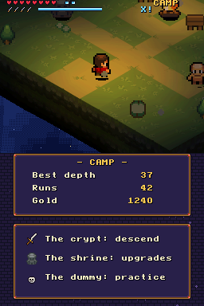
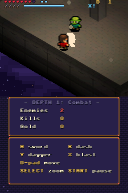
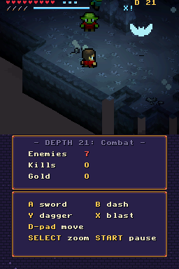
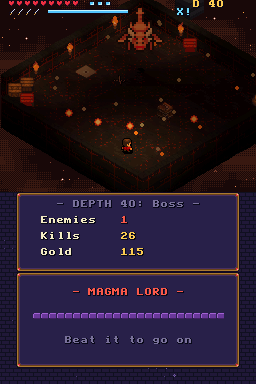

# Delve

*An endless descent.* A room-to-room action roguelike for the Nintendo DS.

Fight through isometric dungeon rooms, pick one of three boons after every
fight, choose your next door by the reward it shows, and go as deep as you
can. When you fall, the gold you found buys permanent upgrades at the camp,
and the descent starts again.

**Website:** [eightyfour.ca/delve](https://eightyfour.ca/delve/) ·
**Download:** [Releases](https://github.com/pandymic/delve-nds/releases)

| | | | |
|---|---|---|---|
|  |  |  |  |
| The camp | The Dungeon | The Crystal Caverns | The Magma Lord |

## Features

- **Endless, seeded rooms.** Every room is generated from the run's seed:
  shapes with pits and chasms, obstacles, traps, breakable props and
  explosive barrels. Exit doors show what lies beyond them: a fight, a rest
  or treasure.
- **Four areas and their bosses.** The Dungeon, the Sunken Sewers, the
  Crystal Caverns and the Molten Depths, ten depths each and a boss at the
  end of each one. Then the order starts again, harder.
- **A full kit.** Sword, dash with invulnerability, thrown daggers, and a
  blast that charges as you land hits. Auto-aim helps when no direction is
  held.
- **Boons and upgrades.** Thirteen stacking boons per run, fifteen permanent
  upgrades bought at the camp's shrine, and waypoints that let later runs
  start in an area you have reached.
- **The look of the DS.** Low-poly 3D rooms with flat shading and dynamic
  light, SNES-style pixel-art sprites as billboards, parallax skies on the 2D
  layers, and two camera zoom levels.
- **Built for the handheld.** Three save slots, run history, first-time
  tips, a left-handed control layout, touch-screen menus, and closing the
  lid pauses the game.
- **Secrets.** There is more to the About screen than meets the eye.

## Playing

You need a way to run homebrew: a DS flashcart, a DSi or 3DS with
[TWiLight Menu++](https://github.com/DS-Homebrew/TWiLightMenu), or an
emulator such as [melonDS](https://melonds.kuribo64.net/).

1. Download `delve-v<version>.nds` from the
   [releases](https://github.com/pandymic/delve-nds/releases).
2. Copy it to your SD card and start it from your loader.

Delve saves through DLDI, the standard homebrew storage interface. The ROM
carries a blank DLDI stub, and nearly every loader patches its own driver
in when it starts a game. If yours does not, build with `make dldipatch`
(it patches in the R4 driver) or patch the ROM with your cart's driver.

Saves (`delve-1.sav` to `delve-3.sav`, one per slot) go next to the ROM when
the loader says where it is, otherwise into `/saves/`, otherwise the card's
root. Without a usable card the game still runs, without saving.

Delve has been tested in melonDS and on a Nintendo 3DS with TWiLight Menu++.

### Controls

| Action | Default | Left-handed |
|---|---|---|
| Move | D-pad | A B X Y |
| Sword | A | Left |
| Dash | B | Down |
| Dagger | Y | Right |
| Blast (when charged) | X | Up |
| Camera zoom | SELECT | SELECT |
| Pause | START (or close the lid) | START |

Menus work with the D-pad and A/B, or by touch.

## Building

Delve builds with [BlocksDS](https://blocksds.skylyrac.net/) and
[Nitro Engine](https://github.com/AntonioND/nitro-engine), installed through
[Wonderful Toolchain](https://wonderful.asie.pl/) (BlocksDS's
[setup guide](https://blocksds.skylyrac.net/docs/setup/linux/) covers the
details):

```sh
# Wonderful Toolchain
curl -fsSLO https://wonderful.asie.pl/bootstrap/wf-bootstrap-x86_64.tar.gz
sudo mkdir -p /opt/wonderful && sudo chown -R "$USER" /opt/wonderful
tar -xzf wf-bootstrap-x86_64.tar.gz -C /opt/wonderful/
export PATH=/opt/wonderful/bin:$PATH
wf-pacman -Syu --noconfirm wf-tools

# BlocksDS and Nitro Engine
wf-config repo enable blocksds
wf-pacman -Syu --noconfirm
wf-pacman -S --noconfirm blocksds-toolchain blocksds-nitroengine
sudo ln -sfn /opt/wonderful/thirdparty/blocksds /opt/blocksds
```

The Makefile looks for `BLOCKSDS=/opt/blocksds/core`,
`BLOCKSDSEXT=/opt/blocksds/external` and `WONDERFUL_TOOLCHAIN=/opt/wonderful`;
set them in the environment if yours are elsewhere. Then:

| Command | Builds |
|---|---|
| `make` | `delve.nds`, the everyday build |
| `make debug` | `delve-debug.nds`, with debug cheats and performance meters |
| `make release` | `delve-v<version>.nds`: runs the tests first, warnings are errors |
| `make test` | Runs the unit tests on your computer (only needs `gcc`) |
| `make dldipatch` | Patches the ROM with the R4 DLDI driver |
| `make clean` | Removes all build output |

The version is kept in one place, the `VERSION` file.

**Debug build.** Hold L and press R to clear the room, hold R and press L to
leave through a door, hold L and press X to fill the blast meter. A meter at
the bottom of the top screen shows CPU time and polygon count per frame. Hold
L + SELECT and press START to test the crash screen, which every build
includes: it reports the CPU registers and the build's commit.

**Assets.** The art in `gfx/` and the audio in `audio/` are generated and
committed, so building needs nothing more. To regenerate them from the
originals in `art/third_party/`, run the scripts in `tools/` with Python 3
(the art scripts need [Pillow](https://python-pillow.org/)):
`import_art.py`, `make_art.py`, `import_music.py` and `make_audio.py`.

## Project layout

```
source/          the game (C11)
  states/        title, menus, the run, the summary, the Easter egg
tests/           unit tests for the platform-independent modules
gfx/, audio/     generated art and sound, converted at build time
art/third_party/ the original CC0 and public-domain art and music
tools/           the asset scripts
```

The gameplay modules (rooms, generation, combat, difficulty, saves) are
plain C with no DS dependencies, so the tests run them on your computer.
Rendering and input live in their own modules on top. Gameplay maths is
fixed point, and every pool is static: nothing is allocated while the game
runs.

## Credits

Delve is by Michal Pandyra, with code written with the help of Claude
(Anthropic).

- **Art:** Shade (Puny Characters, Puny Dungeon, Puny World, Miniworld
  Sprites; CC0) and devurandom (Victoria Bold font; CC0).
- **Music:** Kosmo The Cat (CC0), Beyond, Drozerix and JAM (public domain).
- **Libraries:** BlocksDS and libnds, Nitro Engine, Maxmod.
- **Homage:** a hidden tribute to *Rogue* (1980) by Michael Toy, Glenn
  Wichman and Ken Arnold.

[CREDITS.md](CREDITS.md) has the details and
[LICENSES.md](LICENSES.md) every source and licence.

## Licence

Delve's code, and the art and sound its own tools generate, are released
under the [MIT licence](LICENSE). The third-party art and music keep their
own licences (CC0 or public domain), listed in [LICENSES.md](LICENSES.md).
